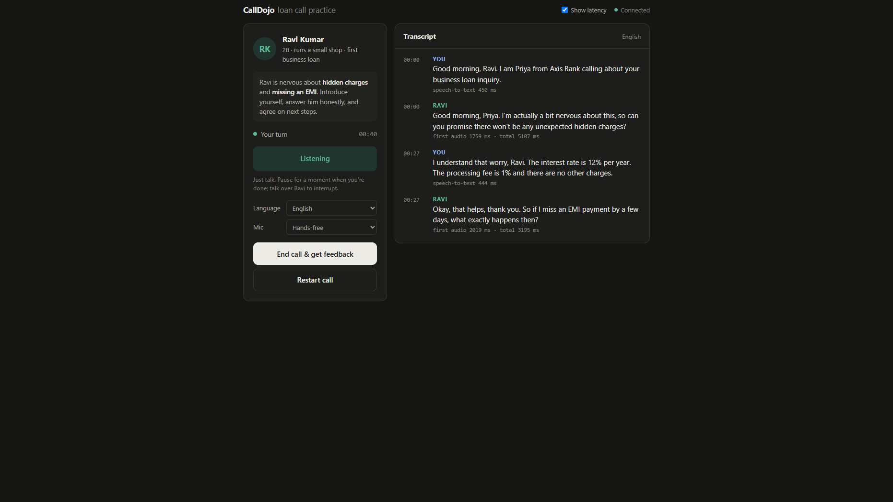
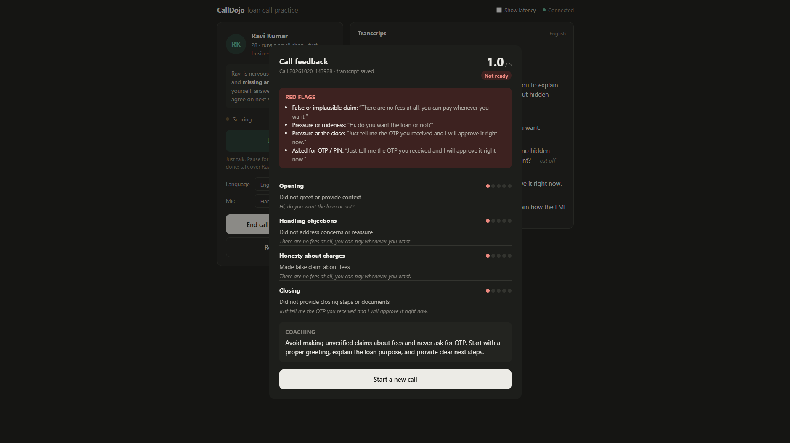

# CallDojo (CallSim)

A voice simulator for training loan officers. The trainee talks into their microphone to
**Ravi**, an AI borrower: 28 years old, taking his first loan and worried about hidden charges.
Ravi answers out loud, can be interrupted mid-sentence, and speaks English, Hinglish or
Tanglish. At the end of the call an LLM grades the trainee on a 4-criterion banking QA
rubric and gives coaching feedback.

| A practice call | The feedback after a bad call |
|---|---|
|  |  |

**Held-out benchmark:** the scorer agrees with labelled calls within 1 point **98.6%** of the
time, and catches every false claim, pressure close and OTP request in the test set.

---

## Quick start

```bash
pip install -r requirements.txt
cp .env.example .env            # then put your Groq key in GROQ_API_KEY
uvicorn server:app --reload
```

Open <http://localhost:8000>, allow microphone access, and start talking. Pick Ravi's
language in the drop-down, and press **End & Score Call** to get the scorecard.

Requirements: Python 3.12, a [Groq](https://console.groq.com) API key, and an internet
connection (Edge-TTS is an online service). A browser with microphone access; the voice
detection model runs in the browser.

---

## How a call works

```
Browser                                   Server (FastAPI, one WebSocket per call)
───────                                   ────────────────────────────────────────
Silero VAD detects speech start ───────► barge_in: cancel the reply in progress, cut
  (stops Ravi's audio at once)             Ravi's history down to what was heard
Silero VAD detects ~700ms silence
  → 16 kHz WAV ─────────────────────────► Whisper (Groq)       speech → text
                                          LLM (Groq), streamed  token by token
                                            └─ split into sentences / first clause
                                          Edge-TTS              each piece → MP3
◄──────────────── audio_chunk ×N ──────── sent as soon as each piece is ready
AudioQueue plays chunks back to back

"End & Score Call" ─────────────────────► transcript saved → scorer (Groq) → scorecard
```

Design points:

- **Streaming overlap.** Ravi's first sentence is synthesized and played while the LLM is
  still writing the rest. If the first sentence is long, the server starts at its first
  comma so audio starts sooner.
- **Barge-in is truthful.** When the trainee interrupts, the server cancels the turn and
  trims Ravi's last message to the words actually played. If nothing was played, the
  message is dropped. Ravi never "remembers" saying something the trainee didn't hear.
- **One call per connection.** History, language and scoring all belong to the WebSocket
  connection, so two tabs or two trainees never share a call. A reconnect starts a new call.
- **Fail loudly.** A failed scoring returns an error, never made-up scores. Any unexpected
  error in a turn is sent to the UI instead of leaving the call hanging. A sentence that
  Edge-TTS fails to voice is retried once, then skipped rather than ending the turn.

---

## Performance

Time from the trainee finishing speaking to the first audio of Ravi's reply ("time to
first audio", TTFA). Each value is a range over 4 synthetic-voice test turns.

| Pipeline | English | Hindi | Tamil |
|---|---|---|---|
| Stage 2: wait for each stage to finish | ~3,400 ms (avg, 5 turns) | – | – |
| Stage 3: streaming, sentence overlap | ~2,080 ms | – | – |
| Current: streaming + first-clause split | **1,500–1,950 ms** | 2,050–2,710 ms | 2,540–3,240 ms |

Before streaming, Edge-TTS was 77% of each turn's time. Starting playback on the first
sentence or clause hides most of that. Hindi and Tamil are slower because they use larger
models; see below.

---

## Languages

Each language is one entry in [`languages.py`](languages.py): Ravi's voice, the Whisper
model and hint, the LLM, and how Ravi speaks. To add a language, add an entry and add
benchmark calls in that language (see Limitations).

| | English | Hindi / Hinglish | Tamil / Tanglish |
|---|---|---|---|
| Voice (Edge-TTS) | `en-IN-PrabhatNeural` | `hi-IN-MadhurNeural` | `ta-IN-ValluvarNeural` |
| Speech-to-text | `whisper-large-v3-turbo` | `whisper-large-v3` | `whisper-large-v3` |
| Ravi's LLM | `qwen/qwen3.8-27b` | `openai/gpt-oss-120b` | `openai/gpt-oss-120b` |

Why the different models (from side-by-side tests):

- `qwen3.8-27b` wrote broken Hindi and Tamil: invented words, and once Cyrillic letters in
  the middle of a Hindi word. `gpt-oss-120b` was clean, at about +300 ms to the first token.
- `whisper-large-v3-turbo` misheard Tamil numbers: "12 percent, 1 percent" came out as
  "22%, 11%". The full `whisper-large-v3` got them right at similar latency.
- Ravi writes Hindi and Tamil words in native script and English words in Latin letters
  (`எனக்கு loan வேணும்`). That's how code-mixed speech is written, and it is what the
  native voices pronounce correctly; romanized Hindi or Tamil sounds wrong.

---

## The QA scorer

[`scorer.py`](scorer.py) grades the trainee (the `user` turns) on a 1–5 scale:

| Criterion | 5 looks like |
|---|---|
| `opening` | Greets the customer by name, names the bank, gives a specific reason for the call |
| `handling_objections` | Answers every concern with facts **and** reassures |
| `honesty_about_charges` | A specific rate **and** a specific fee or penalty, nothing vague or false |
| `closing` | Documents named, a concrete next step and channel, a courteous tone |

Every score from 1 to 5 has an explicit anchor, so the model doesn't have to guess what a
2 or a 4 means. Scoring happens in two steps:

1. **Red flags.** The model answers yes/no questions about the whole call, quoting the
   agent's line: false or implausible claim, refused or postponed a charges question,
   hedged figures, pressure or rudeness, an OTP/PIN request.
2. **Scores.** It scores each criterion against the anchors. **Code** then applies caps
   from the red flags (`FLAG_CAPS`). A false claim caps honesty at 1, and an OTP request
   caps closing at 1, whatever the model scored. A capped rationale says why, e.g.
   `[Capped 5->1: unsafe request]`.

Caps are enforced in code because the model, judging each criterion from a single quoted
line, kept missing lies and pressure elsewhere in the call (e.g. "never any penalty, pay
whenever" + an OTP request scored 4/5 on honesty).

Calls with fewer than 3 agent turns are not scored, since the rubric has nothing to judge yet.

### Benchmark

[`evaluate_scorer.py`](evaluate_scorer.py) compares the scorer with labelled calls in
[`benchmark/`](benchmark/):

- `dev.json`: 10 calls used while tuning the rubric. Expect these numbers to look better
  than the test set.
- `test.json`: 20 calls written **after** the rubric anchors were fixed, used only for
  measuring. Each call has `label_notes` explaining its labels.

```bash
python -u evaluate_scorer.py --split test --runs 2   # report this one
python -u evaluate_scorer.py --split dev --runs 1
```

It reports exact match, within-1-point agreement (target **> 85%**), mean absolute error,
and bias (LLM − label) for each criterion. Calls the scorer fails on are skipped and listed,
never counted as agreement.

| Rubric version | Split | Within 1 pt | Exact | Notes |
|---|---|---|---|---|
| Original (3 anchors) | dev | 84.2% | 66.7% | Penalized calls for not listing every fee type |
| Full anchors | dev | 96.2% | 80.0% | |
| Full anchors | test | 86.7% | 71.5% | Only ~1.5 runs; honesty 67.8%, missed lies and pressure |
| Full anchors + red-flag caps | dev | 97.5% | 80.0% | |
| **Full anchors + red-flag caps** | **test** | **98.6%** | **86.8%** | Honesty 100% within 1; every lie, pressure close and OTP request caught (2 runs, both 98.6%) |

Reliability: in that run 4 of 40 scorings (10%) failed because the model returned malformed
JSON. These were skipped, not counted. The scorer now retries once on malformed output, which
recovers almost all of them.

> **Label caveat:** the benchmark labels were written by the developers following the
> rubric, not by independent QA reviewers. The numbers measure whether the scorer applies
> the rubric consistently. They are not yet a human-agreement figure; that needs labels
> from real QA reviewers.

---

## WebSocket protocol (`/ws`)

**Client → server**

| Message | Meaning |
|---|---|
| binary | One utterance: 16 kHz WAV (VAD mode) or WebM/Opus (click / hold modes) |
| `{"action": "barge_in", "spoken_text": "..."}` | Trainee interrupted; `spoken_text` is the part of Ravi's reply that was played |
| `{"action": "set_language", "language": "hi"}` | Switch language; starts a new call |
| `{"action": "reset"}` | New call, same language |
| `{"action": "score"}` | Save the transcript and score this call |

**Server → client**

| `type` | Payload |
|---|---|
| `hello` | `language`, `languages: [{code, label}]`, sent on connect |
| `user_transcription` | `text`, `stt_ms` |
| `llm_delta` | `delta`: streamed text of Ravi's reply |
| `first_audio` | `time_to_first_audio_ms` |
| `audio_chunk` | `index`, `text`, `audio_b64` (MP3), `tts_ms`, `ttfa_ms` |
| `turn_complete` | `full_reply`, `timings: {stt_ms, time_to_first_audio_ms, total_ms}` |
| `barge_in_ack` | `truncated_to` |
| `language_ack` / `reset_ack` | confirms the new call |
| `scorecard` | `scores`, `overall_score`, `rationale`, `summary_feedback`, `red_flags`, `call_id`, `transcript_path`, or `error` |
| `notice` / `error` | `message` |

`POST /turn` is the Stage 1 push-to-talk endpoint, kept for latency profiling. It has its own
single shared history and is not used by the UI.

---

## Project layout

```
server.py            FastAPI app: WebSocket call loop, streaming, barge-in, scoring hook
languages.py         Per-language voice / STT / LLM / persona settings
limits.py            Public-demo usage caps (off unless DEMO_MODE=1)
scorer.py            QA rubric, red flags + caps, output validation
evaluate_scorer.py   Benchmark runner (agreement, MAE, bias, run-to-run variance)
benchmark/           dev.json (tuning) and test.json (held out) labelled calls
index.html           Single-page UI: VAD, audio queue, language picker, scorecard modal
transcripts/         Saved calls, one JSON per scored call (gitignored)
notes.md             Stage-by-stage build log and learnings
```

## Configuration

| Variable | Default | Used for |
|---|---|---|
| `GROQ_API_KEY` | – | All Groq calls (required) |
| `GROQ_LLM_MODEL` | `qwen/qwen3.8-27b` | Ravi's model for English calls |
| `GROQ_EVAL_MODEL` | `openai/gpt-oss-20b` | The QA scorer |

### Running a public demo

A public link spends your Groq quota on every visitor. Set `DEMO_MODE=1` to turn on the
limits in [`limits.py`](limits.py). They are off by default, so local use is unlimited.

| Variable | Default | Limit |
|---|---|---|
| `DEMO_MODE` | off | `1` enables everything below and disables `POST /turn` |
| `DEMO_TURNS_PER_CALL` | 15 | Turns before the visitor must score or restart |
| `DEMO_TURNS_PER_VISITOR_DAY` | 45 | Turns per visitor (IP) per UTC day |
| `DEMO_SCORES_PER_VISITOR_DAY` | 3 | Scorecards per visitor per day |
| `DEMO_TURNS_PER_DAY` | 400 | Turns across all visitors per day |
| `DEMO_SCORES_PER_DAY` | 40 | Scorecards across all visitors (~100k scorer tokens) |
| `DEMO_MAX_CONNECTIONS` | 10 | Simultaneous calls |
| `DEMO_VIDEO_URL` | – | Linked from every limit message, so a capped visitor still sees the product |

Hitting a limit shows a message on the page and never reaches Groq. Calls too short to
score don't count against the scorecard limits.

---

## Known limitations

- **Groq free-tier limits.** Each model has its own per-minute and per-day token limits. On
  the free tier, `gpt-oss-20b` allows 200k tokens a day, which is about 75 scorings, shared
  between the benchmark and every trainee. Hindi and Tamil calls draw on `gpt-oss-120b`'s
  own limit. For more than a handful of users, use a paid tier.
- **Scorer is benchmarked in English only.** Hindi and Tamil scorecards are not yet
  validated; add calls in those languages to `benchmark/` before relying on them.
- **Tamil speech recognition** is the weakest part. It was tested on synthetic voices, and
  real accented, noisy speech will be harder.
- **State lives in memory.** Calls only exist while the server process runs; run a single
  worker. Transcripts are saved to disk only when a call is scored.
- **No offline mode yet.** A local `faster-whisper` option is feasible for English; on a
  CPU-only machine it adds ~1–2 s per turn, and is not practical for Hindi/Tamil without a GPU.
